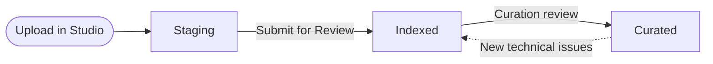

# How content review works on VIVERSE

Every game and experience on VIVERSE is in one of three states: staging, indexed, or curated. This page explains what each state means, who can see your content in it, and how to move to the next one. For the detailed criteria, see [Requirements for indexed content](indexed-requirements.md) and [How to get your content curated](curation.md).

***

## The three content states

Each state adds visibility and has a higher bar than the one before it. Staging doesn't involve review by a member of the VIVERSE content or QA team, indexed needs a short review, and curated needs a longer manual review.

| State | Who can see it | What it takes | Review time |
| --- | --- | --- | --- |
| **Staging** | You, your approved collaborators, and anyone you send a 15-minute share link | Upload your content in VIVERSE Studio | Usually a few minutes, by our automated system |
| **Indexed** | Anyone on VIVERSE, through basic discovery such as the **New** page | Select **Submit for Review** and pass the [indexed requirements](indexed-requirements.md) | Usually 24 to 72 hours |
| **Curated** | Anyone on VIVERSE, with extra weight in our recommendations | Meet the [curation criteria](curation.md). VIVERSE reviews indexed content for curation. | Usually 1 to 3 weeks |

## Staging

Staging is where you test your content on VIVERSE before anyone else can find it. Your content is hosted on VIVERSE and runs the same way it will for players.

In staging, your content is available to:

* The VIVERSE account that uploaded it.
* VIVERSE accounts you add as collaborators. Collaborators can open the content and contribute to it. To add them, see the co-owners setting in [Configure SDK and Access](../how-to-publish.md#configure-sdk-and-access).
* Anyone you send a share link. Use **Guest Preview** in VIVERSE Studio to create a link that lasts 15 minutes, and create a new one each time you send a build to a tester. See **View and Test using a Preview** in [iFraming Your Project on VIVERSE](../iframing-your-project-on-viverse.md).

Staging content doesn't appear in VIVERSE discovery. Staging doesn't involve review by a member of the VIVERSE content or QA team. Our automated system runs a basic malware scan on every upload, which usually takes a few minutes.

## Indexed

Indexed content is public on VIVERSE and appears in basic discovery, such as the **New** page. To move from staging to indexed, select **Submit for Review** in VIVERSE Studio.

The indexed review checks four things: performance on minimum-spec devices, experience-breaking bugs, malware, and compliance with VIVERSE content policies, including an accurate age rating. It usually takes 24 to 72 hours. For the full list and test conditions, see [Requirements for indexed content](indexed-requirements.md).

Indexed content is public. You can set it to private or unlisted in VIVERSE Studio at any time, which removes it from basic discovery. See [Content Management](../publishing-with-your-viverse-account.md) in the VIVERSE Studio guide.

## Curated

Curated content is weighted into the algorithm that powers VIVERSE's curated pages and the sidebar on content detail pages, which suggests more content while players are in a game. Curation is a manual review of indexed content, run by the VIVERSE team.

VIVERSE curates content that raises the standard of quality in the web browser: strong artistry, storytelling, and originality, engaging gameplay, good performance, and a polished experience. The curation review usually takes 1 to 3 weeks. For the criteria and how the review works, see [How to get your content curated](curation.md).

## Updating your content

Every update goes through the same review as indexing before it goes live. This applies to indexed and curated content.

If an update meaningfully changes curated content, VIVERSE may reconsider its curation.

## When content changes state

VIVERSE monitors published content after review. Content can move back to a lower state in these situations:

* **Curated to indexed:** VIVERSE can remove curation at any time if new technical issues are measured. Over time, content may also leave curation if it no longer compares well to other content on the platform.
* **Indexed or curated removal:** VIVERSE can restrict or remove content that no longer meets the [indexed requirements](indexed-requirements.md), violates VIVERSE content policies, or is subject to a valid legal or rights complaint. Urgent action may be taken without notice to protect players, the platform, or third parties.

## iframe permissions and external embedding

These are two separate things. iframe permissions are about features your content uses on VIVERSE. External embedding is about showing your content on another website.

### iframe permissions

VIVERSE shows your content inside an iframe on its own pages. Some browser features, such as `xr-spatial-tracking`, `camera`, and pointer lock, need permission to work inside that iframe. You select these permissions in **Content headers & permissions** when you publish, and confirm them when you **Submit for Review**. For the full list, see [Set Language, Audience, and Permissions](../how-to-publish.md#set-language-audience-and-permissions). To test them in staging, use the **iframe Support for Preview** menu in VIVERSE Studio. See [VIVERSE Studio](../publishing-with-your-viverse-account.md) for details.

### Embedding on external domains

Embedding your VIVERSE content on a website outside VIVERSE is approved case by case. To request it, [open a support ticket](https://support.viverse.com/hc/en-us/requests/new?ticket_form_id=7051418762381) with the content name and the domain where you want to embed it.

## Get help

For questions about review, indexing, or curation, [open a support ticket](https://support.viverse.com/hc/en-us/requests/new?ticket_form_id=7051418762381). For technical help while you build, join the [VIVERSE Discord](https://discord.com/invite/viversecreators).
