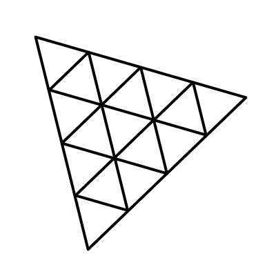

# Overview of 3D Web Rendering Engines

***

## Introduction

In this section, we discuss the features, strengths, and weaknesses of popular 3D rendering engines for the web. Each of these engines is capable of creating high-quality 3D experiences, but developers may prefer one engine over another based on the type of experience they are developing and their development background.

##  Unity

Unity is a feature-packed native game engine that has been used to make some of the most popular indie games of all time. If you have experience developing with other native engines like Unreal Engine and Godot, Unity's development flow will feel natural to you. However, optimizing file size is a challenge for Unity experiences, as Unity supports both native and web platforms.

#### Overview


{% column width="50%" %}
#### :star: Engine Features

2D, 3D, Particles, Photorealistic Rendering, Animations, User Interface, Physics

#### :mobile\_phone:Platform Compatibility

* Built-in support for mobile touch controls
* Integrates well with WebXR

#### :earth\_africa: Developer Community

* Huge community, though the web-specific community is relatively small
* Extensive documentation
* Numerous third-party plugins, though native plug-ins must be manually compiled to Wasm


{% column width="50%" %}
#### :technologist: Developer Experience

* First-Class 3D Editor
* Built-In Version Control
* Extensive tooling for profiling experiences
* Integrates with browser Developer Tools

#### :scroll: Licensing

* Closed source engine
* Free for hobbyists and indie teams
* Paid for teams with over $200k annual revenue.



#### Strengths and Weaknesses

| Strengths                                                                                                                                                                                      | Neutrals                                                                                              | Weaknesses                                                                                                |
| ---------------------------------------------------------------------------------------------------------------------------------------------------------------------------------------------- | ----------------------------------------------------------------------------------------------------- | --------------------------------------------------------------------------------------------------------- |
| <ul><li>High performance ceiling</li><li>First-class feature set</li><li>First-class editor</li><li>Experiences scale well on mobile devices</li><li>Large, high quality asset store</li></ul> | <ul><li>Native game engine</li><li>Write in C#</li><li>Opinionated game engine architecture</li></ul> | <ul><li>WebGL rendering is not the focus of the engine</li><li>Produces large builds by default</li></ul> |

#### Resources

<table><thead><tr><th valign="top">Documentation</th><th valign="top">Optimization Guides</th><th valign="top">Profiling Tools and Guides</th></tr></thead><tbody><tr><td valign="top"><ul><li><a href="https://docs.unity3d.com/Manual/index.html">Core Documentation</a></li><li><a href="https://docs.unity3d.com/Manual/webgl.html">WebGL Documentation</a></li><li><a href="https://docs.unity3d.com/Manual/webgl-gettingstarted.html">Publishing Guide</a></li><li><a href="https://docs.unity3d.com/Manual/webgl-building-distribution.html">Creating Unity Web Builds</a></li></ul></td><td valign="top">
General Performance
<ul><li><a href="https://docs.unity3d.com/Manual/analysis.html">General Unity Optimization</a></li><li><a href="https://docs.unity3d.com/Manual/optimizing-draw-calls.html">Optimizing Draw Calls</a></li><li><a href="https://docs.unity3d.com/Manual/SL-ShaderPerformance.html">Optimizing Shaders</a></li><li><a href="https://docs.unity3d.com/Manual/webgl-technical-overview.html">Technical Limitations</a></li><li><a href="https://docs.unity3d.com/Manual/webgl-memory.html">Web Memory Optimization</a></li><li><a href="https://docs.unity3d.com/Manual/web-graphics-apis-intro.html">Web Graphics Recommendations</a></li><li><a href="https://docs.unity3d.com/Manual/webgl-texture-compression.html">Texture Compression</a></li><li><a href="https://docs.unity3d.com/Manual/wasm-2023-features.html">WebAssembly Optimization</a></li></ul>
Loading Time
<ul><li><a href="https://docs.unity3d.com/Manual/web-optimization.html">Optimizing Web Builds</a></li><li><a href="https://docs.unity3d.com/Manual/web-optimization-mobile.html">Optimizing Web Builds for Mobile</a></li></ul></td><td valign="top"><ul><li><a href="https://docs.unity3d.com/Manual/Profiler.html">Unity Profiler</a></li><li><a href="https://docs.unity3d.com/Manual/performance-profiling-tools.html">Other Profiling Tools</a></li><li><a href="https://docs.unity3d.com/Manual/graphics-performance-profiling.html">Graphics Performance Profiling</a></li><li><a href="https://docs.unity3d.com/6000.3/Documentation/Manual/webgl-debugging.html">Debug Web Builds</a></li><li><a href="https://unity.com/how-to/profile-optimize-web-build#the-importance-of-profiling">How to profile Web Builds</a></li></ul></td></tr></tbody></table>

##  Three.js

Three.js is the most popular 3D rendering library written in JavaScript. It is powerful, lightweight, and highly extensible, making it a good choice for developers who want to keep build sizes small and have more control over the rendering performance of their experience. However, it has few features by default, and must be extended with open source libraries to implement physics and user interfaces.

#### Overview


{% column width="50%" %}
#### :star: Engine Features

3D, Photorealistic Rendering, Animations

#### :mobile\_phone:Platform Compatibility

* No built-in support for mobile touch controls
* Integrates well with WebXR

#### :earth\_africa: Developer Community

* Large community
* Good documentation, numerous examples and tutorials available
* Huge selection of third-party libraries that enable features like physics and user interfaces
* Frameworks like [A-frame](https://aframe.io/) turn Three.js into a true game engine
* Integrates very well with React


{% column width="50%" %}
#### :technologist: Developer Experience

* Extremely rudimentary 3D editor
* No built-in version control
* Integrates well with browser Developer Tools

#### :scroll: Licensing

* Open source engine
* Free to use



#### Strengths and Weaknesses

| Strengths                                                   | Neutrals                                                                                                                      | Weaknesses                                                                                                                                                                                   |
| ----------------------------------------------------------- | ----------------------------------------------------------------------------------------------------------------------------- | -------------------------------------------------------------------------------------------------------------------------------------------------------------------------------------------- |
| <ul><li>Very small builds</li><li>Large community</li></ul> | <ul><li>JavaScript engine</li><li>Flexible architecture</li><li>Requires lots of expertise to get great performance</li></ul> | <ul><li>Only provides rendering logic. Features like UI and physics require third-party libraries </li><li>No asset store. Users must use 3rd party sites to download GLTF assets.</li></ul> |

#### Resources

<table><thead><tr><th valign="top">Documentation</th><th valign="top">Optimization Guides</th><th valign="top">Profiling Tools and Guides</th></tr></thead><tbody><tr><td valign="top"><ul><li><a href="https://threejs.org/manual/#en/creating-a-scene">Documentation</a></li><li><a href="https://discourse.threejs.org/">Forum</a></li><li><a href="https://threejsresources.com/">Learning Resources</a></li></ul></td><td valign="top">
General Performance
<ul><li><a href="https://threejs.org/manual/#en/optimize-lots-of-objects">Rendering Many Objects</a></li><li><a href="https://threejs.org/manual/#en/optimize-lots-of-objects-animated">Rendering Many Animated Objects</a></li><li><a href="https://threejs.org/manual/#en/offscreencanvas">Leveraging Offscreen Canvas</a></li><li><a href="https://threejs.org/manual/#en/cleanup">Memory Management</a></li><li><a href="https://threejs.org/docs/?q=inst#api/en/objects/InstancedMesh">InstancedMesh</a></li><li><a href="https://tympanus.net/codrops/2025/02/11/building-efficient-three-js-scenes-optimize-performance-while-maintaining-quality/">Building Efficient Three.js Scenes</a></li></ul></td><td valign="top"><ul><li><a href="https://threejs.org/manual/#en/debugging-javascript">JavaScript Debugging</a></li><li><a href="https://chromewebstore.google.com/detail/threejs-devtools/jechbjkglifdaldbdbigibihfaclnkbo">DevTools Plugin</a></li><li><a href="https://threejs.org/manual/#en/debugging-glsl">GLSL Debugging</a></li><li><a href="https://github.com/mrdoob/stats.js/">Stats.js</a>: JavaScript Performance Monitor</li></ul></td></tr></tbody></table>

##  PlayCanvas

PlayCanvas is a fully-featured JavaScript engine that has a great developer experience and enables high performance web applications. The engine is less flexible than other JavaScript engines, using a more opinionated Entity-Component System architecture to ensure consistent performance.

#### Overview


{% column width="50%" %}
#### :star: Engine Features

3D, Particles, Animations, Photorealistic Rendering, Physics, User Interface

#### :mobile\_phone:Platform Compatibility

* Built-in support for mobile touch controls
* Integrates with WebXR

#### :earth\_africa: Developer Community

* Medium-size community
* Extensive documentation
* Integrates well with React
* Relatively few third-party libraries


{% column width="50%" %}
#### :technologist: Developer Experience

* First-Class 3D Editor
* Built-In Version Control
* Extensive tooling for profiling experiences
* Integrates with browser Developer Tools

#### :scroll: Licensing

* Open source engine
* Free to use source code
* Some editor features are available as a paid subscription



#### Strengths and Weaknesses

| Strengths                                                                                        | Neutrals                                                                                                                                                                          | Weaknesses                                                                              |
| ------------------------------------------------------------------------------------------------ | --------------------------------------------------------------------------------------------------------------------------------------------------------------------------------- | --------------------------------------------------------------------------------------- |
| <ul><li>High performance ceiling</li><li>Feature-rich editor</li><li>Small build sizes</li></ul> | <ul><li>JavaScript engine</li><li>Opinionated ECS Architecture</li><li>The PlayCanvas Editor is accessible through the browser, rather than as a standalone application</li></ul> | <ul><li>Some editor features are paid</li><li>Comparatively small asset store</li></ul> |

#### Resources

<table><thead><tr><th valign="top">Documentation</th><th valign="top">Optimization Guides</th><th valign="top">Profiling Tools and Guides</th></tr></thead><tbody><tr><td valign="top"><ul><li><a href="https://developer.playcanvas.com/">Documentation</a></li><li><a href="https://developer.playcanvas.com/tutorials/">Tutorials</a></li><li><a href="https://playcanvas.com/products/editor">Editor</a></li><li><a href="https://forum.playcanvas.com/">Forums</a></li></ul></td><td valign="top">
General Performance
<ul><li><a href="https://developer.playcanvas.com/user-manual/optimization/">Optimization</a></li><li><a href="https://developer.playcanvas.com/user-manual/optimization/texture-compression/">Texture Compression</a></li><li><a href="https://developer.playcanvas.com/user-manual/graphics/advanced-rendering/batching/">Batching</a></li><li><a href="https://developer.playcanvas.com/user-manual/graphics/advanced-rendering/hardware-instancing/">Hardware Instancing</a></li><li><a href="https://developer.playcanvas.com/user-manual/graphics/advanced-rendering/indirect-drawing/">Indirect Drawing</a></li><li><a href="https://developer.playcanvas.com/user-manual/xr/optimizing-webxr/">Optimizing WebXR</a></li></ul>
Loading Time
<ul><li><a href="https://developer.playcanvas.com/user-manual/optimization/load-time/">Optimizing Load Time</a></li></ul></td><td valign="top"><ul><li><a href="https://developer.playcanvas.com/user-manual/scripting/debugging/browser-dev-tools/">Browser Dev Tools</a></li><li><a href="https://developer.playcanvas.com/user-manual/optimization/profiler/">PlayCanvas Profiler</a></li><li><a href="https://developer.playcanvas.com/user-manual/optimization/gpu-profiling/">GPU Profiling</a></li><li><a href="https://threejs.org/manual/#en/debugging-javascript">JavaScript Debugging</a></li></ul>

</td></tr></tbody></table>

## Babylon.js

Babylon.js is a fully-featured JavaScript engine that enables great performance, is easy to learn, and has a solid developer tooling ecosystem. Project sizes tend to be larger than PlayCanvas or Three.js, but smaller than Unity. For developers that do not need an editor but want all the features of a modern web rendering engine, Babylon is a great choice.

#### Overview


{% column width="50%" %}
#### :star: Engine Features

3D, Particles, Animations, Photorealistic Rendering, Physics, User Interface

#### :mobile\_phone:Platform Compatibility

* No built-in touch controls
* Integrates well with WebXR

#### :earth\_africa: Developer Community

* Small, active community
* Extensive documentation
* Integrates with JavaScript libraries like React, Angular, and Vue


{% column width="50%" %}
#### :technologist: Developer Experience

* Rudimentary 3D editor
* Rudimentary playground system for prototyping in the browser
* Node-based material editor
* No built-in version control
* The Babylon Inspector and Spector libraries enable extensive profiling in the browser
* Integrates with browser Developer Tools

#### :scroll: Licensing

* Open source engine
* Free to use



#### Strengths and Weaknesses

| Strengths                                                                                          | Neutrals                                                                                         | Weaknesses                                                                                     |
| -------------------------------------------------------------------------------------------------- | ------------------------------------------------------------------------------------------------ | ---------------------------------------------------------------------------------------------- |
| <ul><li>High performance ceiling</li><li>First class WebXR</li><li>Extensive feature set</li></ul> | <ul><li>JavaScript engine</li><li>Flexible architecture</li><li>Supported by Microsoft</li></ul> | <ul><li>Larger file sizes for a JavaScript Engine</li><li>Relatively small community</li></ul> |

#### Resources

<table><thead><tr><th valign="top">Documentation</th><th valign="top">Optimization Guides</th><th valign="top">Profiling Tools and Guides</th></tr></thead><tbody><tr><td valign="top"><ul><li><a href="https://doc.babylonjs.com/">Documentation</a></li><li><a href="https://playground.babylonjs.com/">Playground</a></li><li><a href="https://forum.babylonjs.com/">Forums</a></li></ul></td><td valign="top">
General Performance
<ul><li><a href="https://doc.babylonjs.com/features/featuresDeepDive/scene/optimize_your_scene">Optimization Guide</a></li><li><a href="https://doc.babylonjs.com/features/featuresDeepDive/scene/optimizeOctrees/">Octree Optimization</a></li><li><a href="https://doc.babylonjs.com/features/featuresDeepDive/scene/sceneOptimizer/">SceneOptimizer</a></li><li><a href="https://doc.babylonjs.com/features/featuresDeepDive/scene/offscreenCanvas/">Offscreen Canvas</a></li><li><a href="https://doc.babylonjs.com/features/featuresDeepDive/scene/customLoadingScreen/">Creating Loading Screens</a></li><li><a href="https://doc.babylonjs.com/features/featuresDeepDive/mesh/copies/">Instancing</a></li></ul>
Loading Time
<ul><li><a href="https://doc.babylonjs.com/setup/frameworkPackages/es6Support/">Optimizing build sizes</a></li><li><a href="https://doc.babylonjs.com/features/featuresDeepDive/scene/optimizeCached/">Resource Caching</a></li></ul></td><td valign="top"><ul><li><a href="https://github.com/BabylonJS/Spector.js">Spector</a>: a tool for analyzing draw calls</li><li><a href="https://doc.babylonjs.com/toolsAndResources/inspector/">Babylon Inspector</a></li><li>No asset store. Users must use 3rd party sites to download GLTF assets.</li></ul></td></tr></tbody></table>

